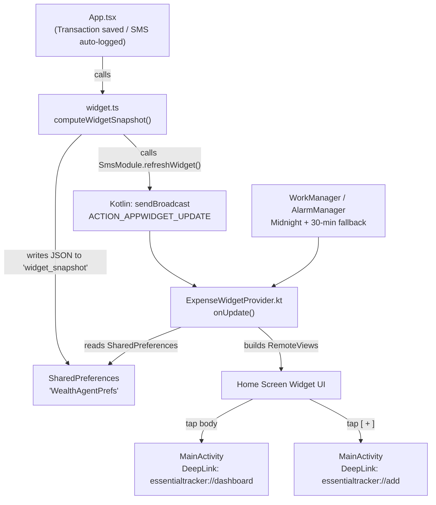

# Essential Tracker — Android Home Screen Widget Plan

> **Scope:** Android AppWidget (AppWidgetProvider in Kotlin) + TypeScript snapshot bridge + optional iOS WidgetKit.
> **Data sources confirmed in codebase:**
> - `Transaction[]` (key `'transactions'`) — all income/expense/transfer records
> - `Debt[]` (key `'debts'`) — loans with `balance`, `interestRate`, `minPayment`
> - `Subscription[]` (key `'subscriptions'`) — recurring bills
> - `WealthConfig` (key `'wealthConfig'`) — income, budget %s, emergency fund
> - Storage: Android `SharedPreferences("WealthAgentPrefs")` via `SmsModule.kt`

---

## Widget Variants & Visual Layout

### Medium Widget — 4×2 (Recommended primary)
```
╔══════════════════════════════════════════════════════════════╗
║  💼 Essential Tracker                      Updated 16:43    ║
║ ─────────────────────────────────────────────────────────── ║
║  TODAY             THIS MONTH            DAILY AVG          ║
║  Rs. 1,450         Rs. 48,200            Rs. 3,215/day      ║
║ ─────────────────────────────────────────────────────────── ║
║  💳 CC Balance     🏦 Loans              🔁 Subs            ║
║  Rs. 23,400        Rs. 185,000           Rs. 4,100/mo       ║
║ ─────────────────────────────────────────────────────────── ║
║  Last: Rs. 650 ▪ Keells Super                   [ + Add ]  ║
╚══════════════════════════════════════════════════════════════╝
```

### Small Widget — 2×2 (Glance-only)
```
╔════════════════════╗
║ Today   Monthly    ║
║ 1,450   48,200     ║
║ ─────────────────  ║
║ Loans  85,000 ⬇️   ║
║          [ + ]     ║
╚════════════════════╝
```

### Large Widget — 4×4 (Full liability dashboard)
```
╔══════════════════════════════════════════════════════════════╗
║  💼 Essential Tracker               🕐 Updated 16:43        ║
║ ─────────────────────────────────────────────────────────── ║
║  SPEND TODAY         SPEND THIS MONTH         DAILY AVG     ║
║  Rs. 1,450           Rs. 48,200               Rs. 3,215/d   ║
║ ─────────────────────────────────────────────────────────── ║
║  LIABILITIES                                                ║
║  🏦 Personal Loan    Rs. 185,000   ██████████░░  65%       ║
║  💳 Credit Card      Rs.  23,400   ████░░░░░░░░  31%       ║
║  🚗 Vehicle Loan     Rs.  44,000   ████████░░░░  55%       ║
║ ─────────────────────────────────────────────────────────── ║
║  💸 Total Liabilities: Rs. 252,400     Min/mo: Rs. 12,500   ║
║  Last: Rs. 650 ▪ Keells Super (Food)           [ + Add ]   ║
╚══════════════════════════════════════════════════════════════╝
```

---

## Architecture & Data Flow



---

## WidgetData Shape (TypeScript)

The TypeScript layer computes a single lightweight snapshot and stores it as JSON in SharedPreferences.

```ts
// src/utils/widget.ts (new file)

export interface WidgetData {
  // ── Expense summary ───────────────────────────────────────
  todayExpense: number;           // net spend today
  monthlyExpense: number;         // net spend this calendar month
  dailyAverage: number;           // monthlyExpense ÷ day-of-month

  // ── Liability snapshot ────────────────────────────────────
  totalLoanBalance: number;       // sum of all Debt.balance (non-credit card)
  creditCardBalance: number;      // sum of Debt.balance where name matches 'credit card'
  totalLiabilities: number;       // totalLoanBalance + creditCardBalance
  totalMinPayment: number;        // sum of all Debt.minPayment
  debts: WidgetDebt[];            // per-debt breakdown (max 3 shown in large widget)

  // ── Credit Card Spending this month ───────────────────────
  creditCardSpendThisMonth: number; // txns where paymentMethod === 'Credit Card', debit

  // ── Subscription burn ─────────────────────────────────────
  subscriptionMonthly: number;    // total subscription cost/month

  // ── Misc ──────────────────────────────────────────────────
  currency: string;               // 'Rs.' derived from WealthConfig or default
  lastUpdated: number;            // Date.now()
  lastTxnDescription?: string;    // most recent transaction description
  lastTxnAmount?: number;
  lastTxnType?: 'credit' | 'debit';
}

export interface WidgetDebt {
  name: string;                   // e.g. "Personal Loan", "Credit Card"
  balance: number;
  minPayment: number;
  type: 'loan' | 'credit_card';
}
```

> [!NOTE]
> The existing `Debt` interface does **not** have a `type` field to distinguish loans from credit cards. We need a small data model extension (see Phase 1 below).

---

## Implementation Phases

### Phase 0 — Data Model Extension (types.ts)

**Problem:** The current `Debt` interface can't distinguish a *personal loan* from a *credit card*.

**Change:** Add a `debtType` discriminator field (fully backward-compatible — default is `'loan'`).

```ts
// src/types.ts — extend Debt interface
export interface Debt {
  id: string;
  name: string;
  balance: number;
  interestRate: number;
  minPayment: number;
  // NEW:
  debtType?: 'loan' | 'credit_card';        // default 'loan' when absent
  creditLimit?: number;                      // for CC: set credit limit to show utilization %
  statementDate?: number;                    // CC billing cycle day (1-31)
  dueDate?: number;                          // CC payment due day
}
```

**UI Change (WealthTab.tsx):** Add a `debtType` picker in the "Add Debt" form:
- Option A: Loan / EMI
- Option B: Credit Card

---

### Phase 1 — TypeScript Snapshot Engine (`src/utils/widget.ts`)

New file. Called every time `transactions`, `debts`, or `subscriptions` change in `App.tsx`.

```ts
import { Transaction, Debt, Subscription, WealthConfig } from '../types';
import { isExpense, isRefund, isTransfer, totals } from './finance';
import { storage } from './storage';
import SmsModule from '../../modules/sms-module/src/SmsModule';

function startOfToday(): number {
  const d = new Date();
  return new Date(d.getFullYear(), d.getMonth(), d.getDate()).getTime();
}

function startOfMonth(): number {
  const d = new Date();
  return new Date(d.getFullYear(), d.getMonth(), 1).getTime();
}

function dayOfMonth(): number {
  return new Date().getDate();
}

export async function updateWidgetData(
  transactions: Transaction[],
  debts: Debt[],
  subscriptions: Subscription[],
  config: WealthConfig,
): Promise<void> {
  const now = Date.now();
  const todayStart = startOfToday();
  const monthStart = startOfMonth();

  // ── Expense summaries ──────────────────────────────────────
  const todayTxns   = transactions.filter(t => t.date >= todayStart);
  const monthTxns   = transactions.filter(t => t.date >= monthStart);

  const todayExpense   = totals(todayTxns).expenses;
  const monthlyExpense = totals(monthTxns).expenses;
  const day            = dayOfMonth();
  const dailyAverage   = day > 0 ? monthlyExpense / day : 0;

  // ── Credit card spending this month ───────────────────────
  const creditCardSpendThisMonth = monthTxns
    .filter(t => t.paymentMethod === 'Credit Card' && isExpense(t))
    .reduce((s, t) => s + t.amount, 0);

  // ── Liability breakdown ───────────────────────────────────
  const loanDebts   = debts.filter(d => (d.debtType ?? 'loan') === 'loan');
  const ccDebts     = debts.filter(d => d.debtType === 'credit_card');

  const totalLoanBalance  = loanDebts.reduce((s, d) => s + d.balance, 0);
  const creditCardBalance = ccDebts.reduce((s, d) => s + d.balance, 0);
  const totalLiabilities  = totalLoanBalance + creditCardBalance;
  const totalMinPayment   = debts.reduce((s, d) => s + d.minPayment, 0);

  const widgetDebts = debts
    .sort((a, b) => b.balance - a.balance)
    .slice(0, 3)
    .map(d => ({
      name: d.name,
      balance: d.balance,
      minPayment: d.minPayment,
      type: (d.debtType ?? 'loan') as 'loan' | 'credit_card',
    }));

  // ── Subscriptions ─────────────────────────────────────────
  const subscriptionMonthly = subscriptions.reduce(
    (s, sub) => s + (sub.cycle === 'yearly' ? sub.cost / 12 : sub.cost), 0
  );

  // ── Last transaction ──────────────────────────────────────
  const lastTxn = [...transactions].sort((a, b) => b.date - a.date)[0];

  const snapshot: WidgetData = {
    todayExpense, monthlyExpense, dailyAverage,
    totalLoanBalance, creditCardBalance, totalLiabilities,
    totalMinPayment, debts: widgetDebts,
    creditCardSpendThisMonth, subscriptionMonthly,
    currency: 'Rs.',
    lastUpdated: now,
    lastTxnDescription: lastTxn?.description,
    lastTxnAmount: lastTxn?.amount,
    lastTxnType: lastTxn?.type,
  };

  // Write to SharedPreferences then push widget update
  await storage.setObject('widget_snapshot', snapshot);
  try {
    await (SmsModule as any).refreshWidget();   // native bridge call
  } catch (_) { /* graceful — widget falls back to 30-min polling */ }
}
```

**Integration in `App.tsx`:** Call `updateWidgetData(transactions, debts, subscriptions, config)` inside the `updateState` helper (already fired on every state mutation) and once on initial app load.

---

### Phase 2 — Native Android AppWidget

**New files inside `android/app/src/main/`:**

```
android/app/src/main/
├── java/com/essentialtracker/app/
│   └── ExpenseWidgetProvider.kt         ← AppWidgetProvider
├── res/
│   ├── layout/
│   │   ├── widget_expense_medium.xml    ← 4×2 layout
│   │   └── widget_expense_small.xml     ← 2×2 layout
│   └── xml/
│       ├── widget_info_medium.xml       ← AppWidget metadata
│       └── widget_info_small.xml
```

#### `ExpenseWidgetProvider.kt`

```kotlin
package com.essentialtracker.app

import android.appwidget.AppWidgetManager
import android.appwidget.AppWidgetProvider
import android.content.Context
import android.content.Intent
import android.app.PendingIntent
import android.widget.RemoteViews
import org.json.JSONObject

class ExpenseWidgetProvider : AppWidgetProvider() {

  override fun onUpdate(ctx: Context, mgr: AppWidgetManager, ids: IntArray) {
    val prefs = ctx.getSharedPreferences("WealthAgentPrefs", Context.MODE_PRIVATE)
    val json  = prefs.getString("widget_snapshot", null)
    val snap  = if (json != null) JSONObject(json) else null

    ids.forEach { id ->
      val views = RemoteViews(ctx.packageName, R.layout.widget_expense_medium)

      // ── Expense summary ──────────────────────────────────
      val todayExp   = snap?.optDouble("todayExpense", 0.0)   ?: 0.0
      val monthExp   = snap?.optDouble("monthlyExpense", 0.0) ?: 0.0
      val dailyAvg   = snap?.optDouble("dailyAverage", 0.0)   ?: 0.0
      views.setTextViewText(R.id.tvTodayExpense,   "Rs. ${todayExp.toInt().commas()}")
      views.setTextViewText(R.id.tvMonthlyExpense, "Rs. ${monthExp.toInt().commas()}")
      views.setTextViewText(R.id.tvDailyAvg,       "Rs. ${dailyAvg.toInt().commas()}/d")

      // ── Liabilities ──────────────────────────────────────
      val ccBal   = snap?.optDouble("creditCardBalance", 0.0) ?: 0.0
      val loanBal = snap?.optDouble("totalLoanBalance", 0.0)  ?: 0.0
      val subMo   = snap?.optDouble("subscriptionMonthly", 0.0) ?: 0.0
      views.setTextViewText(R.id.tvCCBalance,       "Rs. ${ccBal.toInt().commas()}")
      views.setTextViewText(R.id.tvLoanBalance,     "Rs. ${loanBal.toInt().commas()}")
      views.setTextViewText(R.id.tvSubsMonthly,     "Rs. ${subMo.toInt().commas()}/mo")

      // ── Last transaction ──────────────────────────────────
      val lastDesc = snap?.optString("lastTxnDescription", "—") ?: "—"
      val lastAmt  = snap?.optDouble("lastTxnAmount", 0.0) ?: 0.0
      views.setTextViewText(R.id.tvLastTxn,
        "Last: Rs. ${lastAmt.toInt().commas()} · $lastDesc")

      // ── Tap targets ───────────────────────────────────────
      views.setOnClickPendingIntent(R.id.widgetRoot,
        deepLinkIntent(ctx, "essentialtracker://dashboard"))
      views.setOnClickPendingIntent(R.id.btnAdd,
        deepLinkIntent(ctx, "essentialtracker://add"))

      mgr.updateAppWidget(id, views)
    }
  }

  private fun deepLinkIntent(ctx: Context, uri: String): PendingIntent {
    val intent = Intent(Intent.ACTION_VIEW,
      android.net.Uri.parse(uri)).apply {
        setPackage(ctx.packageName)
        flags = Intent.FLAG_ACTIVITY_NEW_TASK or Intent.FLAG_ACTIVITY_CLEAR_TOP
    }
    return PendingIntent.getActivity(ctx, uri.hashCode(), intent,
      PendingIntent.FLAG_UPDATE_CURRENT or PendingIntent.FLAG_IMMUTABLE)
  }

  private fun Int.commas() = "%,d".format(this)
}
```

#### `SmsModule.kt` — Add `refreshWidget()` function

```kotlin
// Add inside ModuleDefinition block in SmsModule.kt

AsyncFunction("refreshWidget") {
  val context = appContext.reactContext ?: throw Exception("React context not available")
  val intent  = Intent(AppWidgetManager.ACTION_APPWIDGET_UPDATE)
  val manager = AppWidgetManager.getInstance(context)
  val ids     = manager.getAppWidgetIds(
    android.content.ComponentName(context, ExpenseWidgetProvider::class.java)
  )
  intent.putExtra(AppWidgetManager.EXTRA_APPWIDGET_IDS, ids)
  context.sendBroadcast(intent)
  return@AsyncFunction true
}
```

#### `AndroidManifest.xml` — Register the widget receiver

```xml
<!-- Inside <application> tag -->
<receiver
  android:name=".ExpenseWidgetProvider"
  android:exported="true"
  android:label="Essential Tracker Widget">
  <intent-filter>
    <action android:name="android.appwidget.action.APPWIDGET_UPDATE" />
  </intent-filter>
  <meta-data
    android:name="android.appwidget.provider"
    android:resource="@xml/widget_info_medium" />
</receiver>
```

#### `res/xml/widget_info_medium.xml`

```xml
<?xml version="1.0" encoding="utf-8"?>
<appwidget-provider xmlns:android="http://schemas.android.com/apk/res/android"
  android:minWidth="250dp"
  android:minHeight="110dp"
  android:targetCellWidth="4"
  android:targetCellHeight="2"
  android:updatePeriodMillis="1800000"
  android:initialLayout="@layout/widget_expense_medium"
  android:widgetCategory="home_screen"
  android:widgetFeatures="reconfigurable|configuration_optional" />
```

---

### Phase 3 — Midnight Rollover & Background Refresh

#### Midnight Reset via WorkManager

A `DailyResetWorker` runs at midnight to push a widget update (so "Today's spend" resets to Rs. 0 without opening the app).

```kotlin
// DailyResetWorker.kt
class DailyResetWorker(ctx: Context, params: WorkerParameters) : Worker(ctx, params) {
  override fun doWork(): Result {
    val mgr  = AppWidgetManager.getInstance(applicationContext)
    val comp  = ComponentName(applicationContext, ExpenseWidgetProvider::class.java)
    val ids   = mgr.getAppWidgetIds(comp)
    val prov  = ExpenseWidgetProvider()
    prov.onUpdate(applicationContext, mgr, ids)
    return Result.success()
  }
}

// Schedule in MainApplication.kt onCreate()
val midnight = WorkManager.getInstance(this)
midnight.enqueueUniquePeriodicWork(
  "widget_midnight_reset",
  ExistingPeriodicWorkPolicy.UPDATE,
  PeriodicWorkRequestBuilder<DailyResetWorker>(1, TimeUnit.DAYS)
    .setInitialDelay(millisUntilMidnight(), TimeUnit.MILLISECONDS)
    .build()
)
```

---

### Phase 4 — Widget UI XML Design

**Dark theme** matching the app — `#12131A` background, `#22D3EE` cyan labels, `#F87171` red for CC/liability.

```xml
<!-- widget_expense_medium.xml (abbreviated) -->
<LinearLayout android:id="@+id/widgetRoot"
  android:background="#CC12131A"   <!-- 80% opaque dark -->
  android:padding="12dp"
  android:orientation="vertical">

  <!-- Header -->
  <TextView android:text="💼 Essential Tracker"
    android:textColor="#E2E8F0" android:textSize="11sp"/>

  <!-- Expense Row -->
  <LinearLayout android:orientation="horizontal">
    <column label="TODAY"    id="tvTodayExpense"   color="#F8FAFC"/>
    <column label="MONTHLY"  id="tvMonthlyExpense" color="#F8FAFC"/>
    <column label="AVG/DAY"  id="tvDailyAvg"       color="#94A3B8"/>
  </LinearLayout>

  <View android:height="1dp" android:background="#334155"/>

  <!-- Liability Row -->
  <LinearLayout android:orientation="horizontal">
    <column emoji="💳" label="CC"    id="tvCCBalance"   color="#F87171"/>
    <column emoji="🏦" label="LOANS" id="tvLoanBalance" color="#FB923C"/>
    <column emoji="🔁" label="SUBS"  id="tvSubsMonthly" color="#94A3B8"/>
  </LinearLayout>

  <!-- Footer -->
  <LinearLayout android:orientation="horizontal">
    <TextView android:id="@+id/tvLastTxn" android:textColor="#64748B"/>
    <Button android:id="@+id/btnAdd" android:text="+" 
      android:background="#22D3EE" android:textColor="#0F172A"/>
  </LinearLayout>
</LinearLayout>
```

---

### Phase 5 (Optional) — iOS WidgetKit

| Step | Action |
|---|---|
| 1 | Create App Group `group.com.essentialtracker.app` in Xcode |
| 2 | Write snapshot to `UserDefaults(suiteName: "group.com.essentialtracker.app")` from JS via `NativeModules` |
| 3 | Add `EssentialTrackerWidget` Swift target using WidgetKit |
| 4 | Build `Provider` struct reading `UserDefaults` to populate `Entry` |
| 5 | Design SwiftUI `WidgetView` with `.systemMedium` and `.systemSmall` sizes |

---

## Summary of File Changes

| File | Change |
|---|---|
| `src/types.ts` | Add `debtType`, `creditLimit`, `statementDate`, `dueDate` to `Debt` |
| `src/utils/widget.ts` | **New** — `computeWidgetSnapshot()` + `updateWidgetData()` |
| `App.tsx` | Call `updateWidgetData()` on every state save + app load |
| `modules/sms-module/android/.../SmsModule.kt` | Add `AsyncFunction("refreshWidget")` |
| `android/app/src/main/java/.../ExpenseWidgetProvider.kt` | **New** — AppWidgetProvider |
| `android/app/src/main/java/.../DailyResetWorker.kt` | **New** — midnight rollover WorkManager job |
| `android/app/src/main/res/layout/widget_expense_medium.xml` | **New** — 4×2 widget layout |
| `android/app/src/main/res/layout/widget_expense_small.xml` | **New** — 2×2 widget layout |
| `android/app/src/main/res/xml/widget_info_medium.xml` | **New** — widget metadata |
| `android/app/src/main/AndroidManifest.xml` | Register `ExpenseWidgetProvider` receiver |
| `src/components/WealthTab.tsx` | Add `debtType` picker in "Add Debt" form |

---

## Open Questions for You

1. **Credit Card detection:** Should we ask the user to tag each `Debt` as *Loan* or *Credit Card* in the existing WealthTab form, or auto-detect by name matching keywords like "Card", "CC", "Visa", "Mastercard"?
2. **CC Statement Balance vs. Running Balance:** Do you want to show the *statement outstanding balance* (manually entered) or the *sum of Credit Card transactions this month*? Both are useful but serve different purposes.
3. **Liability progress bars:** Show payoff % in the large widget (requires knowing original loan amount, which is not in the current `Debt` model — add `originalBalance` field)?
4. **Widget click on a specific debt row:** Should tapping a CC row in the large widget deep-link to the Debts section in the app?
5. **iOS support:** Is iOS a target platform, or Android-only for now?
